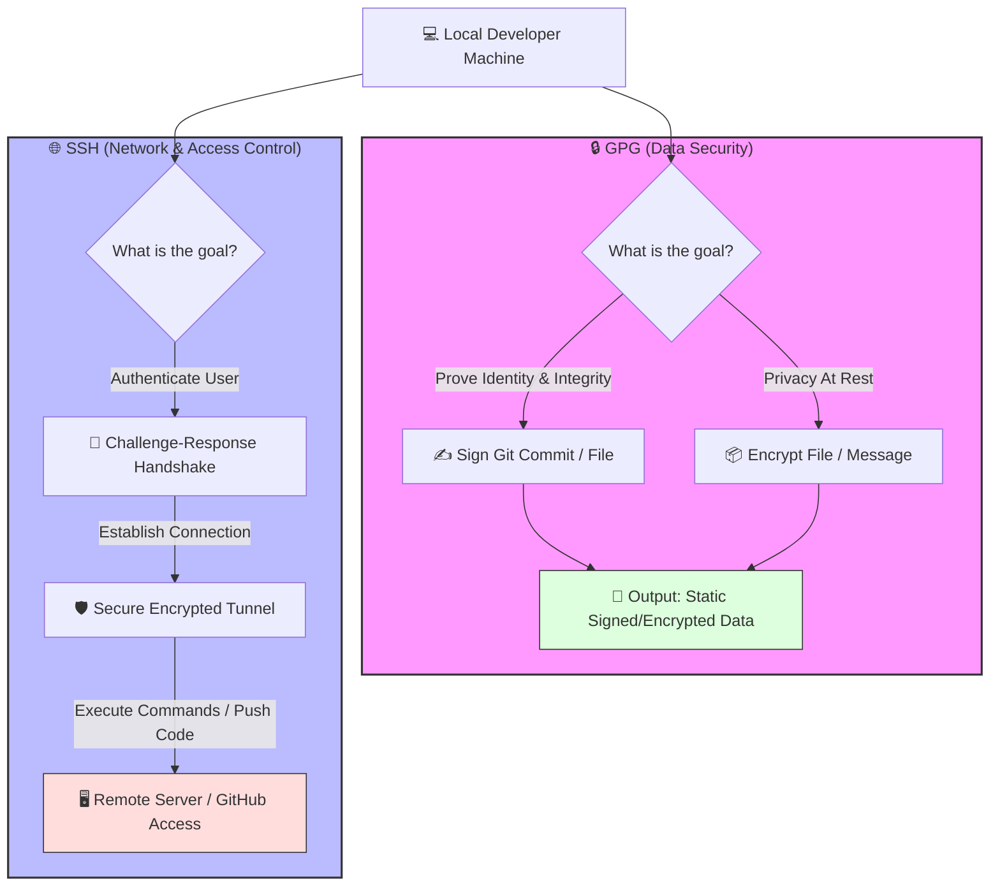

# Cryptographic Protocols, Workflows, & Mermaid Reference Guide

This document provides a comprehensive overview of the fundamental differences between GPG and SSH, visualizes their architectures, details terminal setup workflows, and serves as a complete cheatsheet for writing Mermaid diagrams in Markdown.

---

## Part 1: GPG vs. SSH Architecture

The core difference between **GPG and SSH lies in their primary intent: GPG is designed to secure data (encryption and signing), while SSH is designed to secure connections (remote authentication)**. 

### Quick Comparison

| Feature | GPG (GNU Privacy Guard) | SSH (Secure Shell) |
| :--- | :--- | :--- |
| **Primary Purpose** | **Data Integrity & Privacy:** Encrypts and digitally signs static files, messages, or software releases. | **Remote Access & Auth:** Creates secure communication channels and authenticates users to remote servers. |
| **Common Use Case** | Signing Git commits (the green "Verified" badge) and encrypting emails or files. | Logging into an EC2 server via terminal or pushing/pulling code from GitHub. |
| **Key Architecture** | **Web of Trust:** Keys are typically distributed via public keyservers or direct sharing. | **Authorized Keys:** The remote server must manually store your public key in an `authorized_keys` file. |
| **Data State** | Secures data **at rest** (files or commits remain encrypted/signed permanently). | Secures data **in transit** (only encrypts the live stream of data while connected). |

### Understanding GPG
GPG is an open-source implementation of the OpenPGP standard. It works like a digital wax seal and a locked box. 
* **Signing:** When you sign a Git commit or a software package, GPG proves to the world that *you* explicitly authored it and that the data has not been modified or tampered with since you signed it.
* **Encryption:** Anyone can use your public GPG key to encrypt a file, and absolutely no one except you (with your private key) can decrypt it.

### Understanding SSH
SSH is a protocol specifically built for secure networking. It works like a cryptographic badge reader.
* **Authentication:** When you run `ssh user@server.com`, the server sends a challenge to your local machine. Your SSH client uses your private key to answer that challenge. If it matches the public key already sitting on the server, the door opens and you are granted a shell session.

### The Git/GitHub Intersection
For a long time, the rules in DevOps were strictly separated: you used your **SSH key** to authenticate your terminal so you could push code to GitHub, and your **GPG key** to cryptographically sign the commits inside that code. 

*Note: While Git now supports using SSH keys to sign commits directly (meaning you can ditch GPG if you only care about commit verification), they remain fundamentally different technologies under the hood.*

---

## Part 2: Visual Workflow Mapping



---

## Part 3: Terminal Implementation & Configuration

### 🔑 SSH Configuration (Authentication)

#### 1. Generate an Ed25519 SSH Key
```bash
ssh-keygen -t ed25519 -C "your_email@example.com"
```
*Press Enter to save to the default directory and optionally set a passphrase.*

#### 2. Start the SSH Agent & Add the Key
```bash
eval "$(ssh-agent -s)"
ssh-add ~/.ssh/id_ed25519
```

#### 3. View Public Key to Add to GitHub/Server
```bash
cat ~/.ssh/id_ed25519.pub
```

---

### 🔒 GPG Configuration (Commit Signing)

#### 1. Generate a GPG Key
```bash
gpg --full-generate-key
```
*Select option `1` (RSA and RSA), key size `4096`, and input your name and email (must match your Git configuration).*

#### 2. Get the Long Key ID
```bash
gpg --list-secret-keys --keyid-format=long
```
*Locate the line starting with `sec`. The string after the algorithm (e.g., `rsa4096/3AA5C34371567BD2`) is your key ID (here, `3AA5C34371567BD2`).*

#### 3. Export Public Key for Git Platforms
```bash
gpg --armor --export 3AA5C34371567BD2
```

#### 4. Configure Git to Sign Globally
```bash
git config --global user.signingkey 3AA5C34371567BD2
git config --global commit.gpgsign true
```

---

## Part 4: Mermaid Syntax Cheatsheet

### 1. Chart Types & Declarations
Every Mermaid block must start with the specific diagram type declaration.

```text
%% Flowchart (Vertical or Horizontal)
graph TD  %% Top to Bottom (Alternatively: LR = Left to Right, RL, BT)

%% Sequence Diagram
sequenceDiagram

%% Gantt Chart
gantt

%% Class Diagram
classDiagram

%% State Diagram
stateDiagram-v2

%% Entity Relationship Diagram
erDiagram
```

### 2. Flowchart Nodes & Shapes
Shapes are defined by the brackets used around the text inside a flowchart (`graph` or `flowchart`).

| Node Code | Rendered Shape |
| :--- | :--- |
| `id[Text]` | **Standard Rectangle** |
| `id(Text)` | **Round Edge Rectangle** |
| `id([Text])` | **Stadium/Capsule Shape** |
| `id[[Text]]` | **Subroutine / Double Wall** |
| `id[(Text)]` | **Database / Cylinder** |
| `id((Text))` | **Circle** |
| `id>Text]` | **Asymmetric / Flag Shape** |
| `id{Text}` | **Diamond / Decision** |
| `id{{Text}}` | **Hexagon** |
| `id[\Text\/]` | **Parallelogram** |
| `id[\Text/]` | **Trapezoid** |

### 3. Connectors & Lines (Flowcharts)
Control line styles, arrows, and line labels.

*   `A --> B` — **Arrow link**
*   `A --- B` — **Open link (no arrow)**
*   `A -->|Text| B` — **Link with text inline**
*   `A -- Text --> B` — **Alternative link text syntax**
*   `A -.-> B` — **Dotted link with arrow**
*   `A ==Text==> B` — **Thick link with text**
*   `A x--x B` — **Cross edge on both ends**
*   `A o--o B` — **Circle edge on both ends**

### 4. Sequence Diagram Elements
Used to map out interactions over time (like API calls or auth handshakes).

```text
sequenceDiagram
    autonumber %% Automatically number steps
    actor User as 👤 Developer
    participant Client as 💻 Terminal
    participant Server as 🖥️ GitHub Server

    User->>Client: Type 'git push'
    activate Client
    Client->>+Server: SSH Handshake Challenge
    Server-->>-Client: Challenge Response Accepted
    deactivate Client
    Note over Client,Server: Connection is now secure
    
    rect rgb(240, 240, 240)
        Note right of Server: Optional Loop block
    end
```

**Sequence Line Types:**
*   `->` — **Solid line (no arrow)**
*   `->>` — **Solid line with arrow (Synchronous request)**
*   `-->` — **Dotted line (no arrow)**
*   `-->>` — **Dotted line with arrow (Asynchronous response)**

### 5. Advanced Diagram Structures

#### Entity Relationship (ER) Diagrams
Used for mapping out database architectures, identities, or data object structures.

```text
erDiagram
    USER ||--o{ PUBLIC-KEY : owns
    USER {
        string username
        string email
    }
    PUBLIC-KEY {
        string key_id
        string fingerprint
        string type
    }
```

#### Gantt Charts
Used for plotting timelines, dependencies, and execution tracks.

```text
gantt
    title Development Environment Setup
    dateFormat  YYYY-MM-DD
    section Key Generation
    Generate SSH Key           :active, des1, 2026-10-26, 1d
    Generate GPG Key           :        des2, after des1, 1d
    section Platform Config
    Upload Public Keys to Git  :        des3, after des2, 1d
    Test Authentication        :        des4, after des3, 1d
```

### 6. Grouping & Styling

#### Subgraphs (Group Nodes Together)
```text
subgraph Title ["Visible Display Name"]
    A --> B
end
```

#### Basic Inline Styling
Apply CSS properties directly to individual nodes.
```text
style NodeID fill:#f9f,stroke:#333,stroke-width:4px,color:#fff
```

#### Class Styling (Reusable Styles)
Define a style once and apply it to multiple nodes.
```text
classDef secure fill:#dfd,stroke:#333;
class NodeA,NodeB secure;
```

### 7. Special Characters & Emojis
If you want to use special characters (`>`, `(`, `)`) or markdown inside your node text, wrap the string in **double quotes**.

*   `id1["This string allows <b>HTML</b> tags"]`
*   `id2["This allows emojis! 🚀"]`
